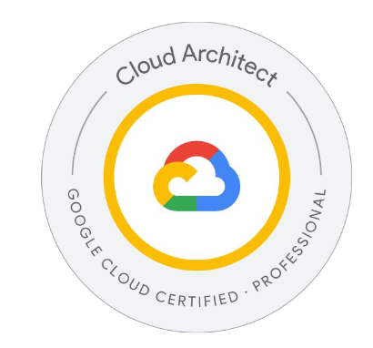
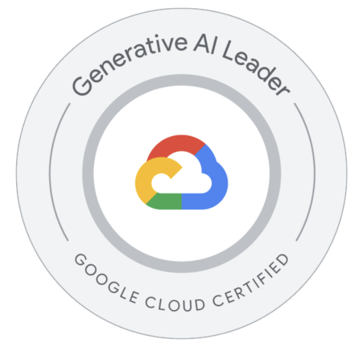
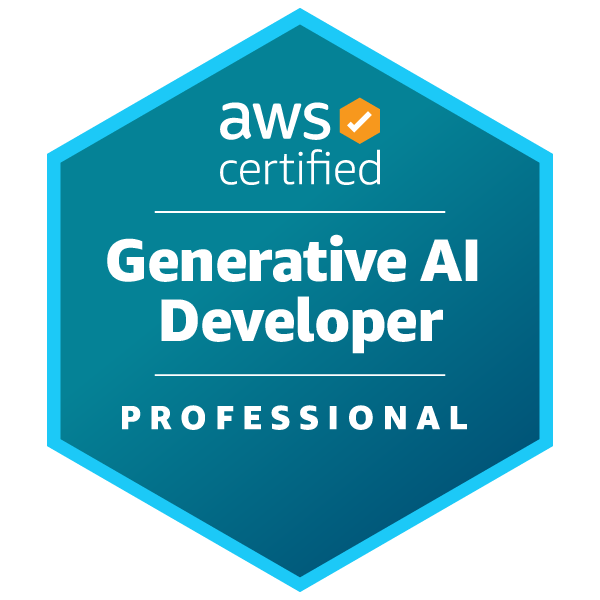
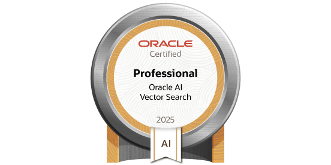
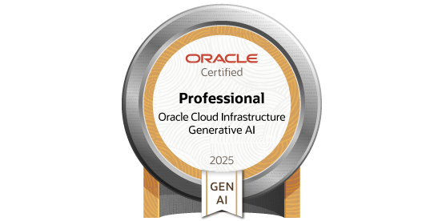
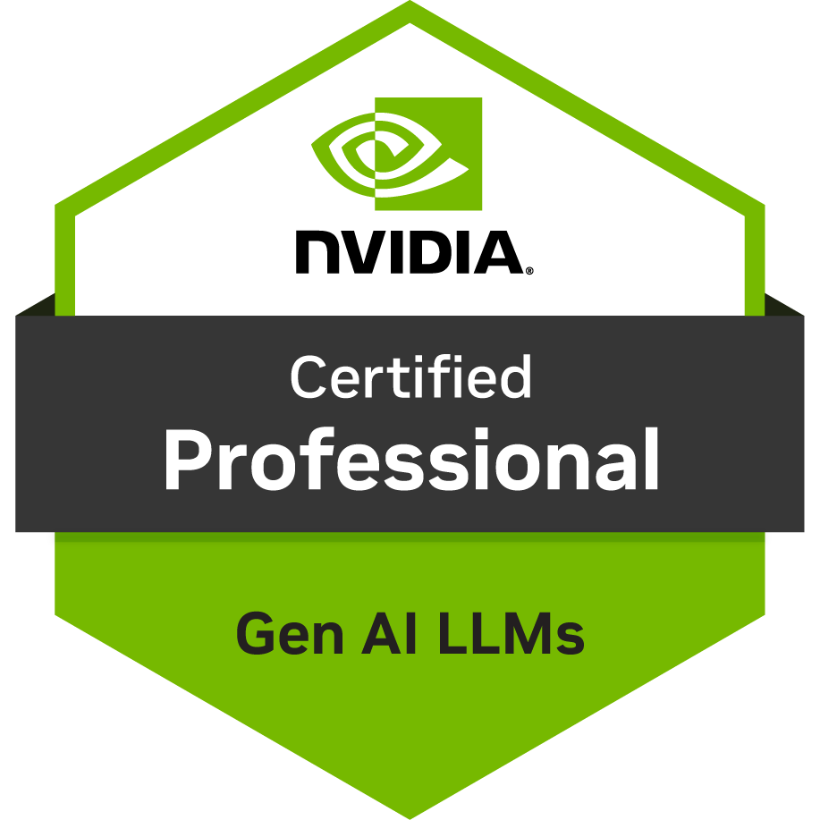

  <h1>Zhanlin Cui · Maverick</h1>
  <h3>AI &amp; Cloud Solution Architect</h3>
  
ByteDance · Volcano Engine

  

    
  

## Experience

**ByteDance · AI & Cloud Solution Architect** · Sep 2026–Present  
AI and cloud solution architecture for growth-stage AI companies, connecting LLM, video, and world-model workloads with infrastructure and delivery requirements.

**Baidu · AI Agent Architecture Engineer** · Apr–Sep 2026  
Agent systems and overseas solution delivery for Medo.dev, spanning multi-model routing, tool orchestration, and multi-agent workflows.

**Xiaomi · AI Innovation Product Manager Intern** · Dec 2025–Mar 2026  
GUI agents, long-term memory, and proactive intelligence across device ecosystems, with scenario prototyping and multimodal evaluation.

**TCL · AI Product Manager Intern, CTO Assistant** · Aug–Nov 2025  
LLM personality evaluation and interaction design for Ai Me, covering proactive behavior, memory quality, safety guardrails, and regression testing.

**China Merchants Bank · FinTech Product Manager Intern** · Dec 2024–Jan 2025  
Research on AI in finance, blockchain payments, and digital banking.

**SAS Institute · AI Credit & Finance Product Lead (Capstone)** · Aug–Nov 2024  
Credit risk platform design linking feature engineering, model inference, configurable decision rules, explainability, and audit trails.

**China Mobile · AIGC Product Manager Intern & System Analyst** · Jun–Sep 2024  
Image generation workflows with Stable Diffusion, custom LoRA training, and web/mobile interfaces.

**BMW · IT Executive Project Manager Assistant** · Dec 2023–Mar 2024  
Enterprise application improvements on Azure and production web risk assessment.

## AI & Engineering Stack

<table>
  <thead>
    <tr><th align="left">Engineering Area</th><th align="left">Technologies &amp; Ecosystem</th></tr>
  </thead>
  <tbody>
    <tr>
      <td width="210" valign="middle"><strong>Agent Architecture &amp; Infrastructure</strong></td>
      <td>
        &nbsp;
        
        &nbsp;
        
        &nbsp;
         LangGraph · LangChain · LlamaIndex · MCP · A2A</td>
    </tr>
    <tr>
      <td width="210" valign="middle"><strong>LLM Engineering &amp; Serving</strong></td>
      <td>
        &nbsp;
        
        &nbsp;
        
        &nbsp;
         PyTorch · Hugging Face · vLLM · SGLang · LiteLLM · TensorRT-LLM</td>
    </tr>
    <tr>
      <td width="210" valign="middle"><strong>Post-Training &amp; Agent RL</strong></td>
      <td>
        &nbsp;
         Transformers · PEFT · TRL · verl · Ray</td>
    </tr>
    <tr>
      <td width="210" valign="middle"><strong>Retrieval, Memory &amp; Evaluation</strong></td>
      <td>
        &nbsp;
        
        &nbsp;
        
        &nbsp;
         PostgreSQL · pgvector · Redis · Qdrant · Langfuse · Ragas</td>
    </tr>
    <tr>
      <td width="210" valign="middle"><strong>Cloud-Native AI Infrastructure</strong></td>
      <td>
        &nbsp;
        
        &nbsp;
        
        &nbsp;
        
        &nbsp;
        
        &nbsp;
         AWS · Azure · Google Cloud · Volcano Engine · Docker · Kubernetes</td>
    </tr>
    <tr>
      <td width="210" valign="middle"><strong>Full-Stack Engineering</strong></td>
      <td>
        &nbsp;
        
        &nbsp;
        
        &nbsp;
        
        &nbsp;
        
        &nbsp;
         Python · TypeScript · Go · React · Next.js · FastAPI</td>
    </tr>
    <tr>
      <td width="210" valign="middle"><strong>iOS &amp; On-Device Intelligence</strong></td>
      <td>
        &nbsp;
        
        &nbsp;
         Swift · SwiftUI · Xcode · Core ML · Foundation Models · MLX</td>
    </tr>
    <tr>
      <td width="210" valign="middle"><strong>Data &amp; Developer Tools</strong></td>
      <td>
        &nbsp;
        
        &nbsp;
        
        &nbsp;
        
        &nbsp;
         MySQL · Git · GitHub Actions · Linux · Figma</td>
    </tr>
    <tr>
      <td width="210" valign="middle"><strong>Models &amp; APIs</strong></td>
      <td>
        &nbsp;
        
        &nbsp;
        
        &nbsp;
        
        &nbsp;
        
        &nbsp;
         OpenAI · Claude · Gemini · Doubao · DeepSeek · Qwen</td>
    </tr>
  </tbody>
</table>

## Certifications

### Google Cloud & AWS

<table>
  <tr>
    <td align="center" width="25%">
       
      <a href="https://www.credly.com/badges/0bf82303-a281-44e8-9949-b8f3bdcd7652"><strong>Google Cloud Professional Cloud Architect</strong></a>
    </td>
    <td align="center" width="25%">
       
      <a href="https://cloud.google.com/learn/certification/generative-ai-leader"><strong>Google Cloud Generative AI Leader</strong></a>
    </td>
    <td align="center" width="25%">
       
      <a href="https://aws.amazon.com/certification/certified-solutions-architect-professional/"><strong>AWS Solutions Architect – Professional</strong></a>
    </td>
    <td align="center" width="25%">
       
      <a href="https://www.credly.com/org/amazon-web-services/badge/aws-certified-generative-ai-developer-professional"><strong>AWS Generative AI Developer – Professional</strong></a>
    </td>
  </tr>
</table>

### Microsoft Azure & AI

<table>
  <tr>
    <td align="center" width="50%">
       
      <a href="https://learn.microsoft.com/en-us/credentials/certifications/azure-solutions-architect/"><strong>Azure Solutions Architect Expert</strong></a>
    </td>
    <td align="center" width="50%">
       
      <a href="https://learn.microsoft.com/en-us/credentials/certifications/agentic-ai-business-solutions-architect/"><strong>Agentic AI Business Solutions Architect</strong></a>
    </td>
  </tr>
</table>

### Oracle

<table>
  <tr>
    <td align="center" width="33%">
       
      <a href="https://catalog-education.oracle.com/pls/certview/sharebadge?id=CD561B46B6BDA6ACFEE3F44D8D0CC3CA17CAF5CB6CFE302F0C1E78F8FED0C97B"><strong>Oracle AI Vector Search Professional</strong></a>
    </td>
    <td align="center" width="33%">
       
      <a href="https://catalog-education.oracle.com/ords/certview/sharebadge?id=5E1855F0901E4D914D7BECD9A6EF010C590A44DA3DD06287A897E07387959543"><strong>Oracle OCI Generative AI Professional</strong></a>
    </td>
    <td align="center" width="33%">
       
      <a href="https://catalog-education.oracle.com/ords/certview/sharebadge?id=F530E94063215B5BAE0DC8B734FB252C72DAC4B9A8641E5509B89D8D4BA8C129"><strong>Oracle MySQL 8.0 Database Administrator Professional</strong></a>
    </td>
  </tr>
</table>

### NVIDIA

<table>
  <tr>
    <td align="center" width="100%">
       
      <a href="https://www.credly.com/badges/a4c75712-78bc-4398-ac6d-990e426ee520"><strong>NVIDIA Certified Professional: Gen AI LLMs</strong></a>
    </td>
  </tr>
</table>

## Education & Community

**UNSW Sydney** · Bachelor of Computer Science · 2023–2026  
President, Google Developer Group UNSW · Founder & Executive President, UCS

Open to collaboration on agent infrastructure, AI systems architecture, and compute–energy optimization.
