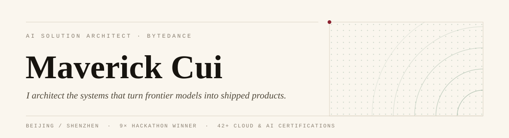
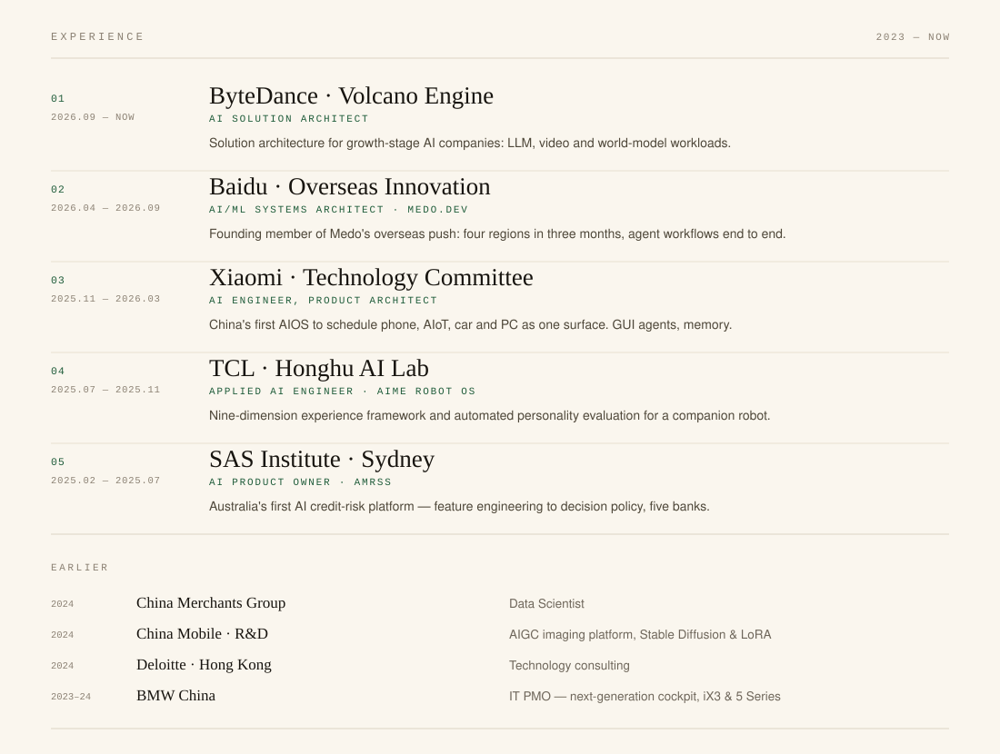

  <picture>
    <source media="(prefers-color-scheme: dark)" srcset="./assets/hero-dark.svg">
    
  </picture>

**AI Solution Architect at ByteDance.** Founder before that.

For four years I've worked on the unglamorous half of AI — agent runtimes, device memory, risk decisioning — at Baidu, Xiaomi and SAS. My own ventures have gone through Antler and other top-tier accelerators.

The conclusion hasn't changed: the model is never the hard part. Everything around it is. That's what I build now for growth-stage AI companies — LLM, video and world-model workloads, from demo to deployed.

---

## Experience

  <picture>
    <source media="(prefers-color-scheme: dark)" srcset="./assets/experience-dark.svg">
    
  </picture>

<b>Plain text version</b>

 

**ByteDance · Volcano Engine** — AI Solution Architect · 2026.09 – now
Solution architecture for growth-stage AI companies, connecting LLM, video and world-model workloads with infrastructure and delivery requirements.

**Baidu · Overseas Innovation** — AI/ML Systems Architect, Medo.dev · 2026.04 – 2026.09
Founding member of the overseas team; four regions in three months. Multi-model routing, tool orchestration, multi-agent workflows, end-to-end solution delivery.

**Xiaomi · Technology Committee** — AI Engineer, Product Architect · 2025.11 – 2026.03
GUI agents, super-Xiaoai memory and proactive intelligence, across the first AIOS in China to schedule phone, AIoT, car and PC as one surface.

**TCL · Honghu AI Lab** — Applied AI Engineer, AiMe Robot OS · 2025.07 – 2025.11
Personality-layer evaluation and interaction strategy for a companion robot: a nine-dimension experience framework plus automated LLM personality evaluation.

**SAS Institute · Sydney** — AI Product Owner, AMRSS · 2025.02 – 2025.07
Australia's first AI credit-risk platform — feature engineering, model inference, decision policy and audit trails in one configurable chain. Deployed at five banks.

**China Merchants Group** — Data Scientist · 2024

**China Mobile R&D** — AIGC imaging platform, Stable Diffusion and LoRA training · 2024

**Deloitte Hong Kong** — Technology consulting · 2024

**BMW China** — IT PMO, next-generation iX3 and 5 Series cockpit · 2023 – 2024

## Recognition

**NVIDIA Hackathon** · three championships across two years · project owner 
风御 — edge AI network security on BlueField DPUs, closing the loop from detection to autonomous defense. And an AI-native org platform for overseas enterprises: control plane, persistent workspace, RSI self-evolution.

**China International Innovation Competition 2025** · national gold · project owner 
Neurowear (patent) — on-device multimodal brain-health management, taking it from a single hospital check to continuous daily observation. DenseFormer-MoE on wearable signals, with long-horizon trend tracking and expert review.

**China International Innovation Competition 2026** · Oceania champion · project owner 
Synkora (patent) — the first compute–energy co-optimization model for AI factories. When to run a job, which site, which GPU, against power prices and delivery deadlines.

## AI & Engineering Stack

<table>
  <thead><tr><th align="left">Engineering Area</th><th align="left">Technologies &amp; Ecosystem</th></tr></thead>
  <tbody>
    <tr>
      <td width="210" valign="middle"><strong>Agent Architecture &amp; Infrastructure</strong></td>
      <td>
        &nbsp;
        
        &nbsp;
        
        &nbsp;
         LangGraph · LangChain · LlamaIndex · MCP · A2A</td>
    </tr>
    <tr>
      <td width="210" valign="middle"><strong>LLM Engineering &amp; Serving</strong></td>
      <td>
        &nbsp;
        
        &nbsp;
        
        &nbsp;
         PyTorch · Hugging Face · vLLM · SGLang · LiteLLM · TensorRT-LLM</td>
    </tr>
    <tr>
      <td width="210" valign="middle"><strong>Retrieval, Memory &amp; Evaluation</strong></td>
      <td>
        &nbsp;
        
        &nbsp;
        
        &nbsp;
         PostgreSQL · pgvector · Redis · Qdrant · Langfuse · Ragas</td>
    </tr>
    <tr>
      <td width="210" valign="middle"><strong>Cloud-Native AI Infrastructure</strong></td>
      <td>
        &nbsp;
        
        &nbsp;
        
        &nbsp;
        
        &nbsp;
        
        &nbsp;
         AWS · Azure · Google Cloud · Volcano Engine · Docker · Kubernetes</td>
    </tr>
    <tr>
      <td width="210" valign="middle"><strong>Full-Stack Engineering</strong></td>
      <td>
        &nbsp;
        
        &nbsp;
        
        &nbsp;
        
        &nbsp;
        
        &nbsp;
         Python · TypeScript · Go · React · Next.js · FastAPI</td>
    </tr>
  </tbody>
</table>

  
More engineering tools

<table>
  <thead><tr><th align="left">Engineering Area</th><th align="left">Technologies &amp; Ecosystem</th></tr></thead>
  <tbody>
    <tr>
      <td width="210" valign="middle"><strong>Post-Training &amp; Agent RL</strong></td>
      <td>
        &nbsp;
         Transformers · PEFT · TRL · verl · Ray</td>
    </tr>
    <tr>
      <td width="210" valign="middle"><strong>iOS &amp; On-Device Intelligence</strong></td>
      <td>
        &nbsp;
        
        &nbsp;
         Swift · SwiftUI · Xcode · Core ML · Foundation Models · MLX</td>
    </tr>
    <tr>
      <td width="210" valign="middle"><strong>Data &amp; Developer Tools</strong></td>
      <td>
        &nbsp;
        
        &nbsp;
        
        &nbsp;
        
        &nbsp;
         MySQL · Git · GitHub Actions · Linux · Figma</td>
    </tr>
    <tr>
      <td width="210" valign="middle"><strong>Models &amp; APIs</strong></td>
      <td>
        &nbsp;
        
        &nbsp;
        
        &nbsp;
        
        &nbsp;
        
        &nbsp;
         OpenAI · Claude · Gemini · Doubao · DeepSeek · Qwen</td>
    </tr>
  </tbody>
</table>

## Certifications

42+ CERTIFICATIONS &#183; 10 CREDENTIALS SHOWN

  &nbsp;&nbsp;&nbsp;
  &nbsp;&nbsp;&nbsp;
  &nbsp;&nbsp;&nbsp;
  &nbsp;&nbsp;&nbsp;
  
    
  &nbsp;&nbsp;&nbsp;
  &nbsp;&nbsp;&nbsp;
  &nbsp;&nbsp;&nbsp;
  &nbsp;&nbsp;&nbsp;
  

  
View credential details

- [Google Cloud Professional Cloud Architect](https://www.credly.com/badges/0bf82303-a281-44e8-9949-b8f3bdcd7652)
- [Google Cloud Generative AI Leader](https://cloud.google.com/learn/certification/generative-ai-leader)
- [AWS Solutions Architect – Professional](https://aws.amazon.com/certification/certified-solutions-architect-professional/)
- [AWS Generative AI Developer – Professional](https://www.credly.com/org/amazon-web-services/badge/aws-certified-generative-ai-developer-professional)
- [Azure Solutions Architect Expert](https://learn.microsoft.com/en-us/credentials/certifications/azure-solutions-architect/)
- [Agentic AI Business Solutions Architect](https://learn.microsoft.com/en-us/credentials/certifications/agentic-ai-business-solutions-architect/)
- [Oracle AI Vector Search Professional](https://catalog-education.oracle.com/pls/certview/sharebadge?id=CD561B46B6BDA6ACFEE3F44D8D0CC3CA17CAF5CB6CFE302F0C1E78F8FED0C97B)
- [Oracle OCI Generative AI Professional](https://catalog-education.oracle.com/ords/certview/sharebadge?id=5E1855F0901E4D914D7BECD9A6EF010C590A44DA3DD06287A897E07387959543)
- [Oracle MySQL 8.0 Database Administrator Professional](https://catalog-education.oracle.com/ords/certview/sharebadge?id=F530E94063215B5BAE0DC8B734FB252C72DAC4B9A8641E5509B89D8D4BA8C129)
- [NVIDIA Certified Professional: Gen AI LLMs](https://www.credly.com/badges/a4c75712-78bc-4398-ac6d-990e426ee520)

## Education & Community

**UNSW Sydney** · Bachelor of Computer Science · 2023 – 2026 · Excellence Scholarship 
President, Google Developer Group UNSW · Founder & Executive President, UCS

---

  
  

WeChat · <code>-MrCui-</code> — bring a question, or just come say hi.

